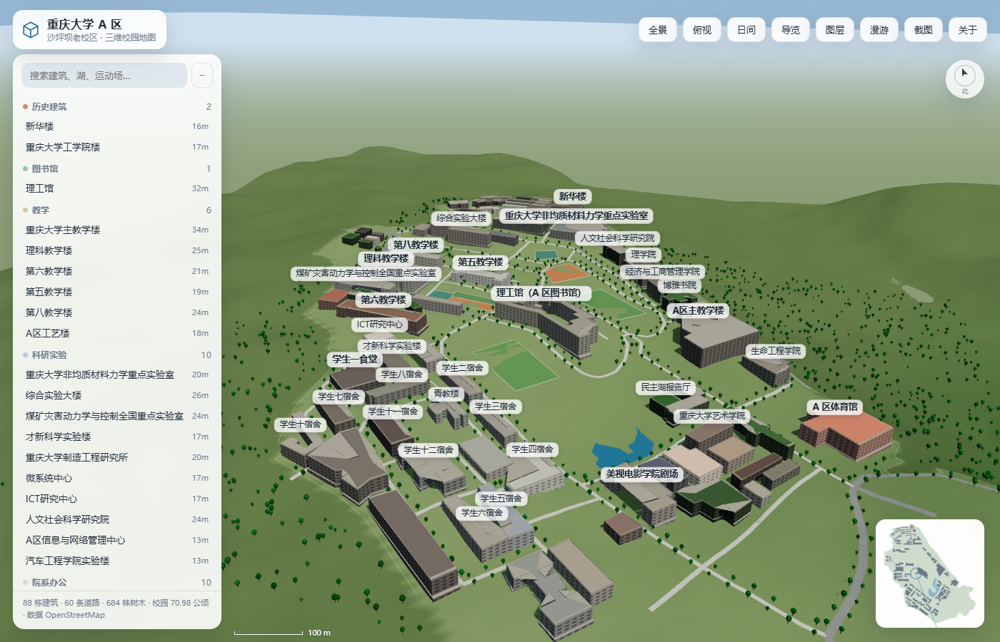
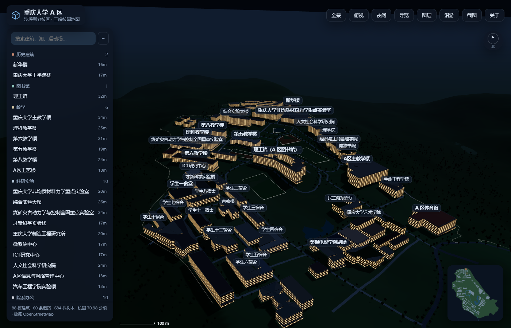

# 重庆大学 A 区 · 三维校园地图

在浏览器里逛沙坪坝老校区（A 区）的三维示意地图：88 栋建筑、民主湖、道路、运动场与树木，按真实坐标 1:1 摆放，建在 **SRTM 实测地形**上（校园内高差约 32 m），支持昼夜光影、地点搜索、自动导览与第一人称步行。





> 灵感来自 [zhipengGui/cqu-campus-3d](https://github.com/zhipengGui/cqu-campus-3d)（虎溪校区版本）。本项目**代码与美术实现完全独立编写**，仅借鉴了「OSM 数据 + Three.js 实时挤出」这一公开的技术思路；参考项目的代码为 All Rights Reserved，未复制任何一行。

## 快速开始

纯静态站点，没有任何构建步骤：

```bash
# 任选一种本地服务器（不要直接双击 index.html，ES Module 需要 http 协议）
python -m http.server 8080
# 或 npx serve .
```

浏览器打开 <http://127.0.0.1:8080>。

Three.js 已 vendor 到 `vendor/`，离线可用，不依赖 CDN。

## 功能

| 功能 | 说明 |
|---|---|
| 三维浏览 | 左键拖动旋转、滚轮缩放、右键平移；触屏单指旋转、双指缩放 |
| 地点列表 | 按建筑性质分组（历史建筑 / 图书馆 / 教学 / 科研实验 / 院系办公 / 宿舍 / 食堂 / 体育），支持搜索 |
| 点击拾取 | 点建筑弹出信息卡：分类、檐高、层数、占地、坐标、简介 |
| 自动导览 | 「导览」沿主教学楼 → 理工馆 → 民主湖 → 五教 → 体育馆 → 美视剧场自动巡游 |
| 第一人称 | 「漫游」进入步行模式，WASD 移动、Shift 加速、鼠标转向、Esc 退出；带建筑与水面碰撞 |
| 昼夜光影 | 日间 / 清晨 / 黄昏 / 夜间四套预设，夜间窗光透出 |
| 图层开关 | 建筑、道路、树木、水面、运动场、标签独立显隐 |
| 小地图 / 罗盘 / 比例尺 | 实时联动，比例尺随缩放换算米数 |
| 分享链接 | `#night`、`#dusk`、`#top`、`#id=<建筑 id>` 直接定位 |
| 截图 | 一键导出当前画面 PNG |

## 数据与坐标

- 建筑轮廓、道路、水面、运动场地、绿地：**OpenStreetMap**（ODbL 1.0），经 Overpass API 抓取。
- 投影：以校园中心 `29.566466 N, 106.466013 E` 为原点的等距圆柱近似，`kx = 111320·cos(lat0)`、`kz = 110574`，单位米，X 向东、Z 向南。
- 校园边界直接取 OSM 中 `name=重庆大学A区` 的 `amenity=university` 多边形，用它裁掉了周边的南开中学、三峡广场与 B 区建筑。
- 高度：优先使用人工覆写表（主教学楼 78 m、理工馆 32 m、A 区体育馆 24 m…），其余按 `层数 × 3.8 + 1.6` 估算；无层数标注时按占地反推。
- 树木：沿步行道与支路两侧程序化撒点，共 684 株；校园外侧坡地另有约 900 株野生树。

数据统计：88 栋建筑 / 60 条道路 / 1 片水面 / 7 块运动场 / 684 株树 / 校园面积 709,768 m²。

### 地形（SRTM）

A 区是坡地，北高南低，落差三十多米，平面图看不出这件事，所以地形是单独做的：

- 高程源：**SRTM 1 弧秒 HGT**（`N29E106.hgt.gz`，3601×3601，约 30 m 网格），取自 AWS `elevation-tiles-prod` 公开桶。
- 处理：`tools/dem2terrain.py` 双线性采样 → 2 遍 3×3 盒式模糊去台阶 → 10 m 重采样网格（208×217，45,136 个高程值）写进 `public/data/campus.json` 的 `terrain` 字段。
- 实测参考高程（m）：工学院楼 268、八教 270、五教 268、综合实验大楼 266、主教学楼 256、理工馆 262、民主湖 238、A 区体育馆 240、美视剧场 240 —— 高点在北侧，低点在南侧和湖边。
- 使用方式：地形网格逐顶点着色（低处偏绿、高处偏黄、陡坡偏土色），建筑按足迹内最低高程落地并向下补 7 m 裙边防悬空，道路按 ≤6 m 自适应细分贴地，水面取水域内低处分位高程让地形自然形成湖岸，树木按采样高程落地。

> 曾经试过把湖面、运动场「开挖」成台地，结果 30 m 精度的 DEM 在上坡侧会削出十几米的假坑；改成「不做削挖、只让几何贴地」后地形才干净。这条弯路记在这里，免得后人再走。

## 目录结构

```
.
├── index.html               # 页面骨架（importmap + UI）
├── favicon.svg
├── src/
│   ├── main.js              # 相机、交互、UI、漫游、小地图
│   ├── scene.js             # 场景构建：地面/天空/道路/水面/建筑/树木/光照预设
│   ├── data.js              # 数据加载、分类表、多边形工具
│   └── style.css            # 主题与布局
├── public/data/campus.json  # 前端消费的校园数据（56 KB）
├── vendor/                  # three 0.170 + OrbitControls（本地化）
└── tools/
    ├── osm2scene.py         # Overpass JSON → campus.json（投影/简化/裁切/分类/高度）
    ├── dem2terrain.py       # SRTM HGT → campus.json 的 terrain 高度场
    ├── plan_check.py        # 生成二维自检图，核对裁切与坐标
    └── deploy.py            # 走 GitHub API 建仓 + 提交（本机 github.com:443 不通时用）
```

## 重新生成数据

```bash
# 1) 抓 OSM（Overpass，A 区 bbox）
curl -s -X POST https://overpass-api.de/api/interpreter --data-urlencode \
  'data=[out:json][timeout:180];(way["building"](29.5638,106.4588,29.5758,106.4722);way["highway"](29.5638,106.4588,29.5758,106.4722);way["natural"="water"](29.5638,106.4588,29.5758,106.4722);way["leisure"](29.5638,106.4588,29.5758,106.4722);way["name"="重庆大学A区"](29.5638,106.4588,29.5758,106.4722););out geom tags;' \
  -o raw_osm_a.json

# 2) 生成 campus.json 与自检图
python tools/osm2scene.py       # 需要 python3（标准库即可）
python tools/dem2terrain.py     # 需要 data/N29E106.hgt（见脚本头部下载地址）
python tools/plan_check.py      # 需要 Pillow
```

改建筑高度请编辑 `tools/osm2scene.py` 里的 `HEIGHT_OVERRIDE` 表，然后重跑上面两步。

## 已知局限

- 只有 A 区。B 区、虎溪、C 区未包含（相距 10 km 以上，坐标无法塞进同一张图）。
- 建筑是「轮廓挤出 + 程序化窗带」，**不是**逐面建模，跟真实立面有差距；重点楼（主教学楼、理工馆、工学院楼）建议后续用 Blender 单独建模替换。
- 屋顶设备、树、田径场看台等细节是程序生成的示意物。
- OSM 里 A 区田径场没有独立 `leisure=track` 要素，所以跑道目前缺失。
- 高度表来源于公开资料与目测，存在误差。
- 地形是 SRTM 30 m 采样，坡向与高差可信，但具体台地边界、挡墙位置不精确；建筑落地高程按足迹最低点取，坡地上下坡侧可能略有嵌埋。
- 校园外的市政道路（沙中路、沙坪坝正街等）没有画，避免在地形边缘悬空。

## 许可

- 代码：MIT。
- 地图数据：© OpenStreetMap contributors，ODbL 1.0。
- 本图为非官方爱好者作品，与重庆大学无隶属关系。

## 发布到 GitHub Pages

仓库根目录就是站点根目录（`index.html` 在根上），所以 Pages 选 `main` / `/` 即可，无需构建。

```bash
# 一条命令发布（走 api.github.com；本机到 github.com:443 会断流，所以不用 git push）
GITHUB_TOKEN=ghp_xxx python tools/deploy.py --repo cqu-campus-a-3d
```

部署后地址：`https://<你的用户名>.github.io/cqu-campus-a-3d/`

要点：

- `.nojekyll` 已就位，避免 Jekyll 处理静态资源；
- 全部资源用相对路径（`./src/`、`./public/data/`），放在子路径下也能正常打开；
- 上传集合只含站点必需文件（约 7.5 MB），`data/` 里的 SRTM 原始高程、瓦片、拼接大图都不上传；
- 单文件版 `cqu-a-3d.html` 也会一起传，便于别人直接下载离线用。
